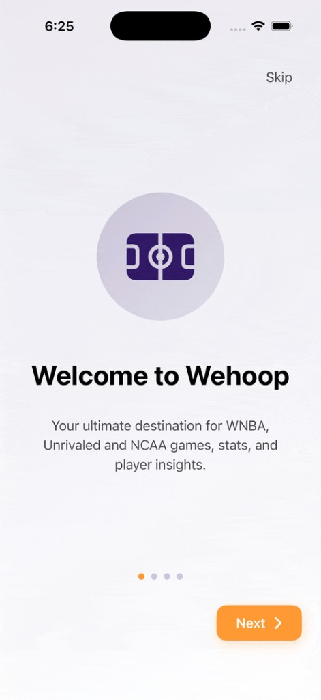

# Wehoop

> Your ultimate destination for WNBA, Unrivaled, and NCAA women's basketball games, stats, and player insights.

[](https://developer.apple.com/ios/)
[](https://swift.org/)
[](https://developer.apple.com/xcode/)

## 📱 About Wehoop

Wehoop is a modern iOS application designed to provide comprehensive coverage of women's basketball. The app covers live games, detailed statistics, player profiles, and team information for WNBA, Unrivaled, and NCAA leagues.

### Key Features

- **🏀 Live Games Feed**: Live scores, box scores, and game statistics
- **📊 League Leaders**: View top performers across multiple statistical categories (scoring, rebounding, assists, etc.)
- **👤 Player Profiles**: Detailed player information including statistics, team affiliation, and career highlights
- **🏆 Team Pages**: Comprehensive team rosters, statistics, and team-specific information
- **⭐ Favorites**: Save and track your favorite players for quick access
- **🎨 Beautiful UI**: Modern, polished interface with smooth animations and transitions

## 🎬 App Demo

### Onboarding Flow & App Usage

A quick walkthrough of the app's onboarding experience and key features:



## 🏗️ Architecture

> **Rebuild in progress (M5).** The app is being rebuilt as a modular Swift 6 app on the
> wehoop-api backend instead of calling a stats provider from the
> phone. The approved plan, module layout and dependency rules are in
> [docs/M5-PLAN.md](docs/M5-PLAN.md). The previous app lives in `Legacy/` as a reference
> until it is deleted before beta.

- `App/`: app target (entry point, composition root, root tabs), generated by XcodeGen from `project.yml`.
- `WehoopKit/`: local Swift package with `Domain`, `Contracts`, `LiveEngine`, `Data`,
  `DesignSystem`, `TestSupport` and one `Feature*` module per screen.
- Feature modules depend only on `Domain` and `DesignSystem`; `scripts/check-deps.sh` enforces it in CI.

## 🚀 Getting Started

### Prerequisites

- **Xcode**: 26.2 or later
- **iOS**: 26.2 or later
- **Swift**: 6.2 tools (Swift 6 language mode)
- **XcodeGen** and **SwiftLint**: `brew install xcodegen swiftlint`

### Installation

1. **Clone the repository:**
   ```bash
   git clone https://github.com/yourusername/wehoop.git
   cd wehoop
   ```

2. **Generate and open the project** (`Wehoop.xcodeproj` is generated, not committed):
   ```bash
   xcodegen generate
   open Wehoop.xcodeproj
   ```

3. **Build and run:**
   - Select your target device or simulator
   - Press `⌘R` to build and run

### First Launch

On first launch, you'll experience:
1. **Onboarding Cards**: Four informative cards introducing the app's features
2. **IntroPage**: An interactive carousel showcasing team logos with infinite scroll
3. **Main App**: Full access to games, players, teams, and statistics

The onboarding flow is feature-gated and can be toggled via the debug menu (shake device in debug builds).

## 📁 Project Structure

The tree below describes the legacy app, now under `Legacy/`. For the new layout see [docs/M5-PLAN.md](docs/M5-PLAN.md).

```
Wehoop/
├── App/                          # App entry point and dependency injection
│   ├── WehoopApp.swift          # Main app entry point
│   ├── DependencyContainer.swift # DI container configuration
│   ├── ViewModelFactory.swift   # Factory for creating ViewModels
│   └── AppCoordinator.swift     # App-level coordination
│
├── Core/                         # Core services and utilities
│   ├── Networking/              # Network service
│   ├── Storage/                 # Storage service implementations
│   ├── Cache/                   # Caching service with expiration
│   ├── Theming/                 # Theme system and team colors
│   └── Utilities/               # Feature flags, logging, extensions
│
├── Domain/                       # Business logic layer
│   ├── Models/                  # Domain models (Game, Player, Team, etc.)
│   ├── UseCases/               # Business logic use cases
│   └── Repositories/           # Repository protocol definitions
│
├── Data/                        # Data layer
│   ├── Repositories/           # Repository implementations
│   ├── DataSources/            # Remote and local data sources
│   │   ├── Sportradar/         # Sportradar API integration
│   │   └── Mock/              # Mock data sources for testing
│   └── DTOs/                   # Data Transfer Objects
│       └── Sportradar/         # Sportradar API DTOs and mappers
│
├── Presentation/                # UI layer
│   ├── Onboarding/            # Onboarding flow and IntroPage
│   ├── TabBar/                # Main tab navigation
│   ├── Games/                 # Games feature (list, detail, box scores)
│   ├── Leaders/               # League leaders and statistics
│   ├── Players/               # Player list and profiles
│   ├── Teams/                 # Team pages and rosters
│   ├── Favorites/             # Favorite players management
│   ├── Settings/               # Settings and feature flags
│   └── Components/            # Reusable UI components
│
└── Resources/                   # Assets and localizable strings
    ├── Assets.xcassets/        # Images, colors, and app icons
    └── Localizable.xcstrings   # Localized strings
```

## 🛠️ Technology Stack

- **SwiftUI**: Modern declarative UI framework for building native iOS interfaces
- **Combine**: Reactive programming framework for data flow and state management
- **Async/Await**: Modern Swift concurrency for asynchronous operations
- **Dependency Injection**: Protocol-based DI container for loose coupling
- **XCTest**: Comprehensive unit and integration testing framework
- **Swift Package Manager**: Dependency management (if applicable)

## 🎯 Key Features in Detail

### Games Feed
- Browse games by date with intuitive date picker
- View live games with live score updates
- Access detailed box scores for finished games
- See game schedules and upcoming matchups
- Organized display: Live games, Upcoming games, Finished games

### League Leaders
- View top performers across multiple statistical categories:
  - Scoring (Points Per Game)
  - Rebounding (Rebounds Per Game)
  - Assists (Assists Per Game)
  - And more...
- Smooth category switching with polished animations
- Detailed player cards with rankings and statistics

### Player Profiles
- Comprehensive player information
- Career statistics and current season performance
- Team affiliation and position
- Search functionality to quickly find players

### Team Pages
- Team rosters with player information
- Team statistics and performance metrics
- Team-specific theming support

### Favorites
- Save favorite players for quick access
- Persistent storage across app launches

## 🧪 Testing

This project includes comprehensive test coverage:

- **Unit Tests**: Use cases, ViewModels, repositories, and services
- **Integration Tests**: End-to-end data flow testing
- **Test Utilities**: Mock repositories and test data factories
- **Test Coverage Goals**: 90%+ for critical components

### Running Tests

```bash
swift test --package-path WehoopKit        # every package module, on macOS, no simulator
xcodegen generate
xcodebuild test -scheme Wehoop -destination 'platform=iOS Simulator,name=iPhone 17'
scripts/check-deps.sh && swiftlint lint --strict
```

See [TESTING.md](TESTING.md) for detailed testing guidelines.

## 🔧 Configuration

### API Configuration

The rebuilt app ships **no provider API key** and needs no configuration file: it reads
data only from the wehoop-api backend. The `Config.xcconfig` setup applies to the legacy
app in `Legacy/` only.

### Feature Flags

The app uses feature flags for gradual feature rollouts:
- Toggle features via Settings → Feature Flags (debug builds)
- All flags default to **enabled** for better user experience
- Flags persist across app launches

## 📝 Development Workflow

This project uses a feature branch workflow:

1. **Create a feature branch:**
   ```bash
   git checkout -b feature/your-feature-name
   ```

2. **Make changes and commit:**
   ```bash
   git add .
   git commit -m "feat: Add your feature description"
   ```

3. **Merge to main:**
   ```bash
   git checkout main
   git merge feature/your-feature-name
   ```

See [CONTRIBUTING.md](CONTRIBUTING.md) and [GIT_WORKFLOW.md](GIT_WORKFLOW.md) for detailed guidelines.

## 📦 Distribution

### Beta Testing

The app supports multiple beta testing methods:

- **TestFlight** (Recommended): Official Apple beta testing platform
- **Ad-Hoc Distribution**: Direct device installation
- **Internal Testing**: Quick distribution to team members

See the [Beta Testing section](#sharing-the-app-for-beta-testing) below for detailed instructions.

## 📚 Additional Documentation

- [API Configuration Setup](API_CONFIGURATION_SETUP.md)
- [Testing Guidelines](TESTING.md)
- [Contributing Guide](CONTRIBUTING.md)
- [Git Workflow](GIT_WORKFLOW.md)

## 📄 License

[Add your license here]

## 👥 Contributing

We welcome contributions! Please read [CONTRIBUTING.md](CONTRIBUTING.md) for details on our code of conduct and the process for submitting pull requests.

---

## Sharing the App for Beta Testing

When you're ready to share the app with potential users for testing, you have several options. Here's a comprehensive guide to the most common approaches:

### 1. TestFlight (Recommended) ⭐

**TestFlight** is Apple's official beta testing platform and the easiest way to distribute your app to testers.

#### Pros:
- ✅ Official Apple solution, integrated with App Store Connect
- ✅ Easy for testers (just install TestFlight app)
- ✅ Automatic updates when you upload new builds
- ✅ Supports up to 10,000 external testers
- ✅ Built-in crash reporting and feedback collection
- ✅ No need to manage device UDIDs manually
- ✅ Testers can provide feedback directly through TestFlight

#### Cons:
- ❌ Requires an Apple Developer account ($99/year)
- ❌ Requires App Store Connect setup
- ❌ Builds must pass App Store review (usually 24-48 hours for beta)
- ❌ Testers need iOS 13+ and the TestFlight app

#### Steps:

1. **Prepare Your App:**
   - Ensure your app has a proper bundle identifier
   - Set up code signing with your Apple Developer account
   - Configure your app's version and build number

2. **Archive Your App:**
   - In Xcode, select **Product → Archive**
   - Wait for the archive to complete

3. **Upload to App Store Connect:**
   - In the Organizer window, click **Distribute App**
   - Select **App Store Connect**
   - Choose **Upload** (not Export)
   - Follow the prompts to upload your archive

4. **Set Up TestFlight in App Store Connect:**
   - Go to [App Store Connect](https://appstoreconnect.apple.com)
   - Navigate to your app → **TestFlight** tab
   - Wait for processing (usually 10-30 minutes)
   - Add internal testers (up to 100) or external testers (up to 10,000)
   - Invite testers via email

5. **Testers Install:**
   - Testers receive an email invitation
   - They install the TestFlight app from the App Store
   - They accept the invitation and install your app

#### Quick Checklist:
- [ ] Apple Developer account active
- [ ] App Store Connect app created
- [ ] Archive created in Xcode
- [ ] Build uploaded to App Store Connect
- [ ] TestFlight processing complete
- [ ] Testers added and invited

---

### 2. Ad-Hoc Distribution

**Ad-Hoc Distribution** allows you to distribute your app directly to specific devices without going through the App Store.

#### Pros:
- ✅ No App Store review process
- ✅ Direct control over distribution
- ✅ Works for internal testing
- ✅ Can be distributed via email, website, or file sharing

#### Cons:
- ❌ Limited to 100 devices per year (per Apple Developer account)
- ❌ Requires collecting device UDIDs manually
- ❌ Testers need to trust your developer certificate
- ❌ No automatic updates (must redistribute manually)
- ❌ More complex setup for testers

#### Steps:

1. **Collect Device UDIDs:**
   - Testers provide their device UDID (Settings → General → About → find UDID)
   - Add UDIDs to your Apple Developer account:
     - Go to [developer.apple.com](https://developer.apple.com)
     - Navigate to **Certificates, Identifiers & Profiles**
     - Add devices under **Devices**

2. **Create Ad-Hoc Provisioning Profile:**
   - In Xcode: **Preferences → Accounts → Your Team → Download Manual Profiles**
   - Or create in Apple Developer portal:
     - Go to **Profiles** → **+** → **Ad Hoc**
     - Select your App ID
     - Select the devices you want to include
     - Download the profile

3. **Archive and Export:**
   - In Xcode: **Product → Archive**
   - Click **Distribute App**
   - Select **Ad Hoc**
   - Choose your provisioning profile
   - Export to a folder

4. **Distribute:**
   - Share the `.ipa` file with testers
   - Testers install via:
     - **macOS**: Drag `.ipa` to iTunes/Apple Configurator
     - **iOS**: Use tools like 3uTools, or install via Xcode
     - **Web**: Host on a website with proper MIME type

---

### 3. App Store Connect Internal Testing

**Internal Testing** is a subset of TestFlight that allows immediate distribution to up to 100 internal testers (team members).

#### Pros:
- ✅ Instant distribution (no beta review)
- ✅ Up to 100 internal testers
- ✅ Same TestFlight experience for testers
- ✅ Good for quick internal validation

#### Cons:
- ❌ Limited to team members only
- ❌ Still requires App Store Connect setup
- ❌ Requires Apple Developer account

#### Steps:

1. **Upload Build** (same as TestFlight steps 1-3)
2. **Add Internal Testers:**
   - In App Store Connect → **Users and Access**
   - Add team members as **App Manager** or **Admin**
   - They automatically become internal testers
3. **Distribute Build:**
   - Go to **TestFlight → Internal Testing**
   - Select your build
   - Internal testers can install immediately

---

### Recommendation

For most use cases, **TestFlight is the best option** because:
- It's the most user-friendly for testers
- It provides the best feedback collection
- It scales well (up to 10,000 testers)
- It's the standard in the iOS ecosystem

Use **Ad-Hoc Distribution** only if:
- You need to test before App Store Connect setup
- You have very specific device requirements
- You're doing internal-only testing with a small team

---

### Additional Resources

- [TestFlight Documentation](https://developer.apple.com/testflight/)
- [App Store Connect Help](https://help.apple.com/app-store-connect/)
- [Ad-Hoc Distribution Guide](https://developer.apple.com/documentation/xcode/distributing-your-app-for-beta-testing-and-releases)
